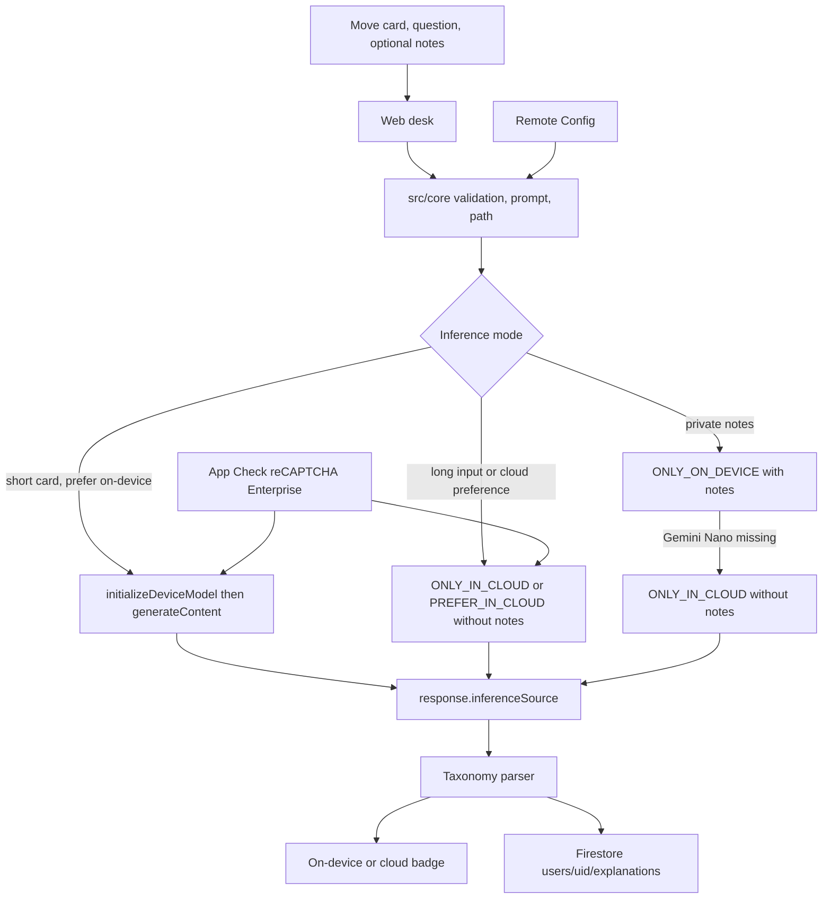
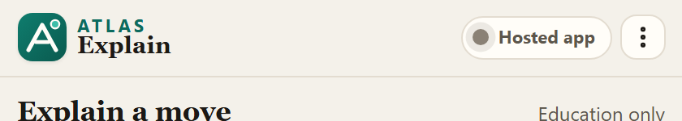
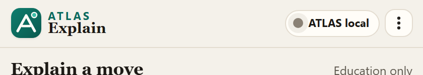
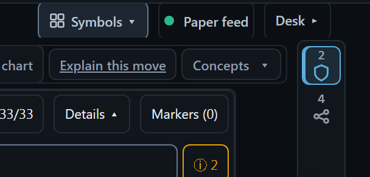
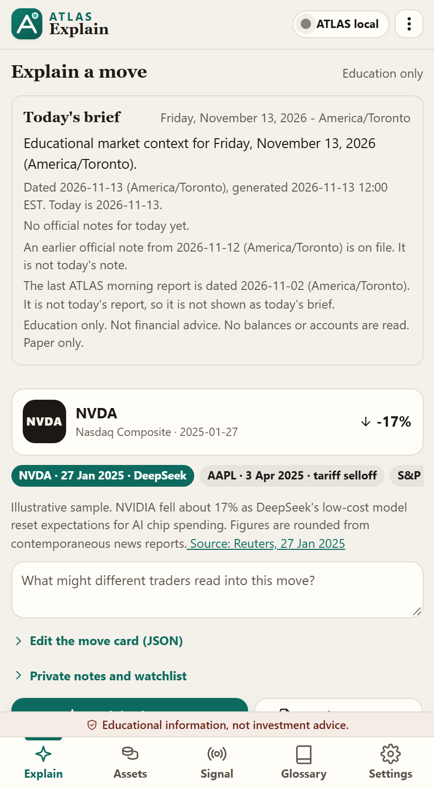
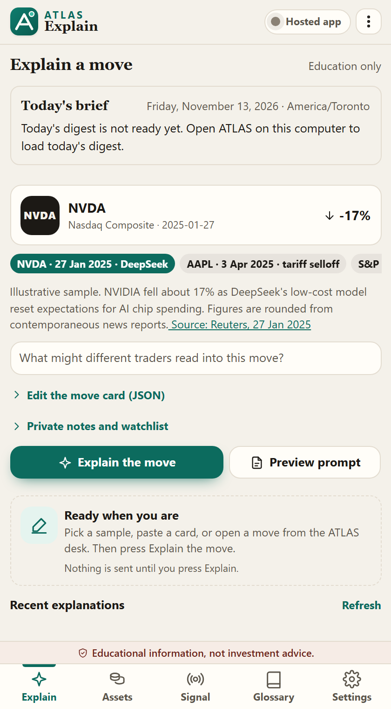
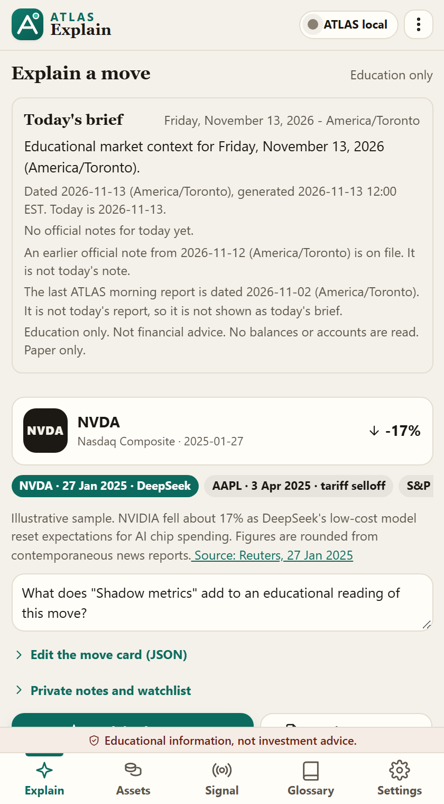
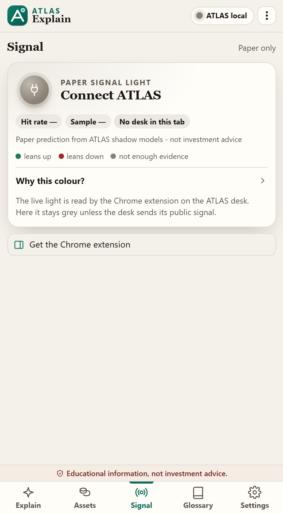
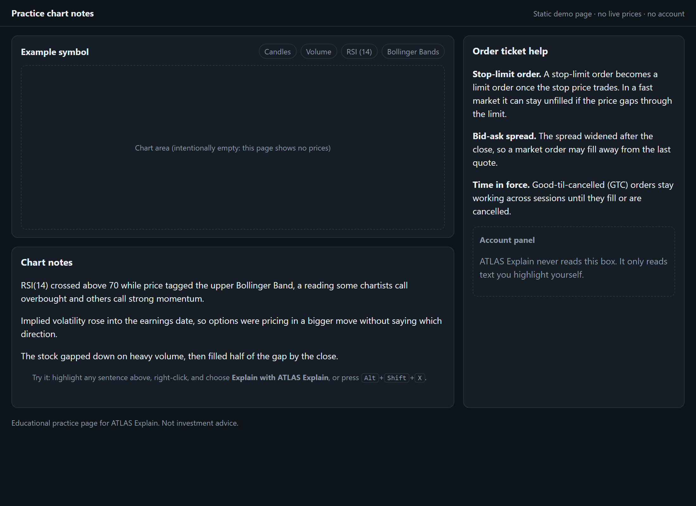

# ATLAS Explain

Educational explanations of a market move. After a sharp drop, ATLAS Explain turns a structured move card into a balanced account of why a buyer might see opportunity and why a seller might see further risk. It is free to use, Apache-2.0, and it does not tell anyone to trade.

The model runs through **Firebase AI Logic hybrid inference**. Chrome uses Gemini Nano on the device when that model is available, and Gemini in the cloud when it is not. The screen names the path that actually ran.

This is an entry for [Google's #BuildHybridAI 2026 hackathon](https://firebasehybridaihackathon.devpost.com/).

> Educational explanations only. Not financial advice, not a recommendation, and not an offer to buy or sell any security.

## Value proposition

A sharp move can support two careful readings at once. Someone might buy a dip because the drop looks larger than the new information. Someone else might sell because the same information can keep pressuring the price. ATLAS Explain makes both readings explicit from a move card the user supplies: symbol, percent move, volume versus normal, the market and sector that day, peers, volatility, upcoming events, and optional headlines.

Headline text is classified into a fixed taxonomy: AI capex, China / export rules, scandal / governance, earnings / guidance, rates / Fed, macro shock, or other. The answer is always three buyer reasons, three seller reasons, and what would change the picture.

Private notes and a watchlist can ride along **only** when the on-device model runs. They are omitted from cloud prompts and they are never written to Firestore.

## How Firebase AI Logic hybrid inference is used

The web client uses the Firebase JavaScript SDK (`firebase@13.3.0`) and the hybrid API documented here:

- [Build hybrid experiences in Web apps](https://firebase.google.com/docs/ai-logic/hybrid/web/get-started)
- [Configuration options](https://firebase.google.com/docs/ai-logic/hybrid/web/configuration-options)
- [Structured output for hybrid experiences](https://firebase.google.com/docs/ai-logic/hybrid/web/generate-structured-output)
- [`InferenceMode` reference](https://firebase.google.com/docs/reference/js/ai.inferencemode)

Checked against `@firebase/ai` 3.1.0 typings shipped with that SDK. The calls are:

| Step | API | Where it runs |
| --- | --- | --- |
| Gemini Developer API backend | `getAI(app, { backend: new GoogleAIBackend() })` | `src/platform/web/explainer.ts` line 45 |
| Mode | `InferenceMode.PREFER_ON_DEVICE`, `ONLY_ON_DEVICE`, `PREFER_IN_CLOUD`, or `ONLY_IN_CLOUD` | `src/platform/web/explainer.ts` lines 37–41 |
| Model | `getGenerativeModel(ai, { mode, inCloudParams, onDeviceParams })` | `src/platform/web/explainer.ts` lines 95–125 |
| On-device init, after the Explain click | `model.initializeDeviceModel(onDownloadProgress)` | `src/platform/web/explainer.ts` lines 127–132 |
| Inference | `model.generateContent(prompt)` | `src/platform/web/explainer.ts` line 144 |
| Which path ran | `result.response.inferenceSource` (`on_device` or `in_cloud`) | `src/platform/web/explainer.ts` lines 148 and 159–167 |

`inCloudParams.generationConfig` sets `responseMimeType: "application/json"` and a `responseSchema` built with `Schema.object` / `Schema.enumString`. The same schema is passed to the on-device model as `onDeviceParams.promptOptions.responseConstraint`, which is what the hybrid structured-output guide requires so both paths return the same shape.

The cloud model id defaults to `gemini-3.5-flash-lite` (the SDK 13 default) and can be changed with Remote Config. Temperature is not sent: the SDK marks it unsupported on Gemini 3.x and later.

Path selection before that call lives in `src/core/inference-path.ts` (`selectInferencePath`, line 20) and is applied in `src/core/run-explanation.ts` (lines 52 and 69):

- Remote Config `inference_mode` is the preference. The in-app default is `prefer_on_device`.
- More than 8 headlines, a prompt over 6,000 characters, or a document over 1,200 characters forces `ONLY_IN_CLOUD`. On-device Gemini Nano's context is 9,216 tokens.
- Notes and the watchlist are included only on an `ONLY_ON_DEVICE` call. If the device model is unavailable and the preference was `prefer_on_device`, the app retries once in the cloud with those fields removed.

App Check, Remote Config, and Firestore are started in `src/platform/web/backend.ts`:

- App Check with `ReCaptchaEnterpriseProvider`: lines 58–61. A debug token is assigned just above that, and only in `npm run dev`.
- Remote Config `fetchAndActivate` and `getValue`: lines 65–89. In-app defaults in `src/core/settings.ts` match `remoteconfig.template.json`.
- Firestore `addDoc` under `users/{uid}/explanations`: line 117. Anonymous Authentication supplies the uid.

Without a Firebase web config and a reCAPTCHA Enterprise site key, `src/main.ts` lines 27–28 render a setup screen and do not initialize Firebase.

## Architecture

`src/core` has no Firebase and no DOM. A Chrome extension or an Android shell can reuse the move card, the prompt, the taxonomy parser, and the path decision. The web UI and the extension popup share one wallet shell in `src/wallet/`; the web app (`src/web/app.ts`) mounts it over a `WebBackend`.



## Setup

Requirements: Node.js 22 or newer, a Firebase project on the Spark plan or above, and Chrome when you want the on-device path. `npm install` may print an engine warning from the `firebase` package, which declares a newer Node for running the SDK inside Node. This app bundles the SDK for the browser and does not run inference in Node.

```bash
npm install
npm run dev
```

The public web config for project `atlas-explain` is committed in `src/platform/web/firebaseConfig.ts` and is used when the `VITE_` variables are unset. `.env.example` lists optional overrides for a different Firebase project. Copy it to `.env.local` only if you need those overrides. Do not commit service-account keys.

### This Firebase project

`atlas-explain` is on the Spark plan. AI Logic uses the Gemini Developer API with App Check enforced. Anonymous Authentication is on. Firestore is the `(default)` database in `nam5`, in production mode. App Check uses a score-based reCAPTCHA Enterprise key limited to `atlas-explain.web.app` and `atlas-explain.firebaseapp.com`. Localhost is not on that key.

### App Check debug token (localhost)

`npm run dev` sets `self.FIREBASE_APPCHECK_DEBUG_TOKEN = true` before `initializeAppCheck`. A production build does not set it, even if `VITE_APPCHECK_DEBUG_TOKEN` is present.

1. Run `npm run dev` and open the local URL.
2. Open the browser developer console. The App Check SDK prints a line like `AppCheck debug token: "..."`.
3. In the Firebase console, go to **Security → App Check → Apps**, open the web app, and choose **Manage debug tokens**.
4. Add the token from the console, then reload the app. Cloud calls stay blocked until that token is registered.
5. To reuse a token you already registered, set `VITE_APPCHECK_DEBUG_TOKEN` in `.env.local` to that token. Set it to `false` to turn the debug provider off. Do not add `localhost` to the production reCAPTCHA key.

### Firebase console (another project)

1. Create a project. Analytics is optional.
2. Register a **Web** app and copy its config into `.env.local` using the `VITE_FIREBASE_*` names in `.env.example`.
3. Open **AI Services → AI Logic** and finish **Get started** with the **Gemini Developer API**. Leave App Check enforced.
4. Create a **score-based** reCAPTCHA Enterprise key and register the web app in App Check. Put the key in `VITE_RECAPTCHA_ENTERPRISE_SITE_KEY`.
5. Enable **Authentication → Anonymous**.
6. Create a Firestore database. Rules allow a signed-in user to read and write only `users/{their uid}/explanations/*`, and they reject documents that contain `notes` or `watchlist`.
7. Remote Config parameters, also compiled into `src/core/settings.ts` until a template is published: `inference_mode`, `cloud_model`, `prompt_template`, `topic_taxonomy`, `on_device_max_headlines`, `on_device_max_chars`, `long_document_chars`, `max_output_tokens`. Prompt placeholders are `{{TAXONOMY}}`, `{{QUESTION}}`, `{{MOVE_CARD}}`, and `{{PRIVATE_CONTEXT}}`. Taxonomy ids are fixed in code; Remote Config can rename labels or hide an id, and `other` is always kept.

## Deploy

`.firebaserc` selects project `atlas-explain`. `firebase.json` publishes Hosting from `dist/` with a single-page rewrite, Firestore rules from `firestore.rules`, and Remote Config from `remoteconfig.template.json`.

Sign in once:

```bash
npx firebase-tools login
```

Run the release gate, then deploy hosting, rules, and Remote Config:

```bash
npm run release:check   # typecheck, lint, test, both builds, manifest, bundle budget, audit, trade-word scan
npx firebase-tools deploy --only hosting,firestore:rules,remoteconfig
```

Billing is shipped switched off. `billing_enabled` defaults to false, checkout is not shown, and the badge says "Free during beta". See [docs/MONETIZATION.md](docs/MONETIZATION.md) before changing that.

## Deep links, desk hand-off, and concepts

ATLAS Explain can load a public move card from a link or from a message sent by an allowed page. It never auto-runs an explanation. The user still clicks **Explain the move**. Notes, watchlists, balances, and account fields are stripped on the way in and are not written into the editor.

The context envelope is version 1:

```json
{
  "v": 1,
  "kind": "move_card",
  "source": "atlas_desk",
  "card": { "symbol": "BTCUSDT", "asOf": "2026-11-12", "movePct": -6.2 },
  "question": "Why might some traders buy this dip while others sell?",
  "concepts": ["shadow"]
}
```

A bare public move card (the existing JSON shape) is also accepted. Allowed card fields are the public `MoveCard` keys in `src/core/move-card.ts`. Forbidden keys include `notes`, `watchlist`, balances, positions, account identifiers, and secrets.

**Hash links** keep the payload out of Hosting query logs:

- `https://atlas-explain.web.app/#c=<base64url(JSON)>`
- `https://atlas-explain.web.app/#card=<uri-encoded JSON>` for a small card
- `https://atlas-explain.web.app/#concept=shadow` to open a glossary entry without a card

`src/core/context-link.ts` builds and parses these hashes. Concept ids live in `src/core/glossary.ts`: `shadow`, `signal15`, `chart_layers`, `live_lock`, `paper_only`, `drop_study`, `hybrid_inference`, and `move_card`.

**postMessage**, for a same-machine ATLAS desk tab or a future extension page that is not implemented in this change:

```js
otherWindow.postMessage(
  { type: "atlas-explain/v1/load", payload: envelope, concept: "chart_layers" },
  "https://atlas-explain.web.app",
);
```

The app accepts that type only from `https://atlas-explain.web.app`, `https://atlas-explain.firebaseapp.com`, `http://localhost:3000`, and `http://127.0.0.1:3000`. It replies with `atlas-explain/v1/loaded` or `atlas-explain/v1/error`. This repository still does not contain ATLAS models, signals, or account data.

## Connecting to ATLAS

ATLAS Explain never reads balances, positions, or account ids. When it talks to the private ATLAS desk, it uses this repo's connectors library (`src/connectors/`, see [docs/connectors/README.md](docs/connectors/README.md)):

1. The hosted web app at https://atlas-explain.web.app **never calls localhost**. Its header pill says **Hosted app**.
2. The Chrome extension and a local loopback build may probe ATLAS on this computer. They prefer public MCP (`POST /api/mcp/public`) and fall back to the REST catalog (`GET /api/explain/assets`).
3. The header says **ATLAS local** only when one of those probes actually answers. It says **ATLAS desk** when this tab is the Markets desk, **Offline** when the browser is offline, and **Not connected** when nothing has answered. It does not fake a connection.

The desk can also open this app with a public move card (`#c=` / `#card=`) or a glossary concept (`#concept=`). Loading a card does not run the model until you click **Explain the move**.

## Screenshots

Stills live in [docs/screenshots/](docs/screenshots/). They show honest header states, the desk hand-off, today's brief, the Signal tab's grey default, and the practice page. An on-device badge is **not** included: that still needs a recording on a laptop with Gemini Nano (see [docs/DEMO.md](docs/DEMO.md)).



The hosted web app at https://atlas-explain.web.app shows **Hosted app** and never calls localhost.



A local loopback build shows **ATLAS local** only when public MCP or the REST catalog on this computer answers.



The private ATLAS desk can open this app with a public move card (`#c=` / `#card=`) or a glossary concept (`#concept=`).



Today's brief stays in view. Earlier official notes and a prior morning report are labelled as not today, and are not presented as today's brief.



On the hosted app, today's digest stays not-ready until ATLAS on this computer can load it.



A `#concept=shadow` link fills an educational question. Nothing is sent until you click **Explain the move**.



The Signal tab stays grey unless the desk sends its public signal. This is the honest default when there is not enough evidence, or when this tab is not the desk.



The practice page uses static, educational language. It has no live prices and no account fields.

## On-device model in Chrome

On-device inference needs Chrome on desktop, version 139 or newer ([getting started guide](https://firebase.google.com/docs/ai-logic/hybrid/web/get-started)):

1. Set `chrome://flags/#prompt-api-for-gemini-nano-multimodal-input` to **Enabled** and restart Chrome.
2. Optional, in DevTools: `await LanguageModel.availability()`, then `await LanguageModel.create()` if the result is `downloadable`. The first download can take several minutes.
3. Click **Explain the move**. `initializeDeviceModel` runs from that click, which satisfies Chrome's user-activation rule. The badge then reads **On-device** or **Cloud** from `inferenceSource`.

If Nano is not available and the card has no private notes, `PREFER_ON_DEVICE` falls through to the cloud model inside the SDK. If the card has notes, the first call is device-only so the notes cannot take the cloud fallback; a failure retries in the cloud without them, and the badge says so.

## Demo

Try the highlight flow on a static practice page with no prices and no account: [atlas-explain.web.app/demo/trading-terms.html](https://atlas-explain.web.app/demo/trading-terms.html). Highlight a sentence, right-click, and choose **Explain with ATLAS Explain**, or press `Alt+Shift+X`. `Alt+Shift+E` opens the Explain popup.

The full three-minute script (ATLAS desk → Explain → on-device badge → two-sided reasons → highlighted text on a trading page → Recent and Learn path → signal light) is in [docs/DEMO.md](docs/DEMO.md). The submission checklist is in [docs/SUBMISSION.md](docs/SUBMISSION.md).

| Step | What the judge sees |
| --- | --- |
| 1 | The ATLAS desk's **Explain this move** opens a public move card in the wallet. Nothing runs until the click. |
| 2 | **Explain the move** runs Firebase AI Logic hybrid inference; the badge names the path that ran (on-device Gemini Nano or cloud Gemini). |
| 3 | Three reasons a buyer might weigh, three a seller might weigh, and what would change the picture. |
| 4 | On a trading or charting page, a highlighted sentence is explained in the same wallet, with the site type (charting, broker, crypto exchange, market news) read from the site name only. |
| 5 | Recent explanations and Learn path progress stay on the device. |

## Chrome extension

The Manifest V3 extension lives in `extension/` and reuses `src/core` for the prompt, the refusal rules, and the billing entitlements. It tries Chrome's Prompt API (Gemini Nano) first. If that model is unavailable, it calls Firebase AI Logic with `InferenceMode.ONLY_IN_CLOUD` on the same `atlas-explain` project. The popup says which path answered.

Each explanation is a click: the toolbar icon, the selection context menu **Explain with ATLAS Explain**, the `Alt+Shift+X` shortcut (or `Alt+Shift+E` to open the popup), or a button you add to the current page. The extension sends the highlighted text, the page title, and the site name. The site name and title also tell it what kind of page the highlight came from (charting site, broker, crypto exchange, market news, or the ATLAS desk), so an "RSI" on a charting site is read as an indicator; the page body is never read. Recent explanations and Learn path progress are kept in `chrome.storage.local` on the device only. It does not read form fields, balances, or account numbers. On-device answers are unlimited. Cloud answers follow `billing_enabled` (off during beta, so they are free).

`scripting` is included with `activeTab` so the highlight and the page button run only after that click. `sidePanel` is optional.

Load it unpacked:

1. `npm run build:extension`
2. Open `chrome://extensions`, turn on Developer mode, and choose **Load unpacked**.
3. Select `extension/dist`.
4. For Gemini Nano, use Chrome on desktop, version 139 or newer, and set `chrome://flags/#prompt-api-for-gemini-nano-multimodal-input` to Enabled.
5. The reCAPTCHA key does not include `chrome-extension://` origins. For a cloud fallback while unpacked, register an App Check debug token and paste it into **Settings → AI** in the popup.
6. To light the signal, open the ATLAS Markets desk (`http://localhost:3000/markets`) in the active tab, then click the toolbar icon. The desk answers the popup's `atlas-explain/v1/request-context` message with its public payload. Only `lean`, `hitRate`, `sampleSize`, and `reason` are read.

`npm run build:extension` writes `extension/atlas-explain-chrome.zip`. For a Chrome Web Store release, bump the version with `npm version <x.y.z>` (it updates `extension/manifest.json` too), then `npm run release:extension` writes `release/atlas-explain-chrome-v<x.y.z>.zip` and its `.sha256`; upload that zip. Listing images are in `extension/store/`. The identity is documented in [docs/BRAND.md](docs/BRAND.md). The listing should say the extension is educational and not investment advice. Do not ship an App Check debug token in the store build.

The popup opens like a wallet menu that drops down from the toolbar, with Explain, Signal, Glossary, and Settings tabs. The hosted web app shows the same wallet, centred. Explanations of highlighted text appear in the same popup, with loading, empty, error, and offline states. The layout, motion, and icon rules are in [docs/BRAND.md](docs/BRAND.md). A signal light at the top stays grey unless a shadow model has cleared the evidence gate. Today none have, so the honest state is grey, or "connect ATLAS" when the desk tab is not open. The light never says buy or sell.

## Tests and CI

```bash
npm run release:check
```

That one command runs the Node version check, typecheck, lint, tests, the web and extension builds, the manifest least-privilege check, the bundle budget (every chunk ≤ 500 kB, popup ≤ 120 kB), `npm audit` (must be 0) and the trade-word scan, and stops at the first failure. Hosting sends a strict CSP and security headers from `firebase.json`. Node `^22.12 || ^24` (`.nvmrc` = 24). Audit overrides are explained in [docs/DEPENDENCIES.md](docs/DEPENDENCIES.md).

Unit tests cover move-card validation, prompt building, the taxonomy parser, inference-path selection, the explain retry that drops private notes, and the Firebase AI Logic calls with `firebase/ai` mocked. GitHub Actions (`.github/workflows/ci.yml`) runs the same steps on Node 22.

`npm run remote-config` rewrites `remoteconfig.template.json` from the in-app defaults. A test fails if the two drift.

## Limitations

- On-device inference is Chrome on desktop, version 139 or newer, with the Prompt API flag. Other browsers use the cloud path.
- On-device context is 9,216 tokens. Long cards are sent to the cloud without private notes. Hybrid mode does not support multi-turn chat, token counting, or the Live API.
- The on-device model can still return slightly messy JSON. The parser coerces unknown topics to `other` and rejects an answer that does not contain three reasons on each side.
- Sample cards are illustrative. January 27, 2025 and April 3–4, 2025 figures are rounded from contemporaneous Reuters, AP, BBC, and CNBC reports linked on the card. They are not a licensed feed, and this repo does not ship Polygon, Yahoo, or Coinbase data. The blank card's −6% is a placeholder.
- Anonymous history is tied to the browser profile. Clearing site data starts a new user.
- App Check debug tokens are for localhost only. Production needs the reCAPTCHA Enterprise key and enforcement left on.
- Explanations can be wrong, incomplete, or too confident. They are not research from the private ATLAS desk and they are not a forecast.

## Relationship to ATLAS

ATLAS is a private, paper-only trading-research desk. ATLAS Explain is a separate public companion. This repository does not contain ATLAS models, signals, notebooks, positions, or data. A move card exists only because someone pasted it, picked a labeled sample, or loaded their own saved explanation.

## What to build next

**Chrome extension.** Shipped in `extension/` (see above). Next: a Chrome Web Store listing, and structured output on the extension's on-device path so its answers use the same buyer/seller schema as the web app.

**Android shell.** Port the move card, prompt, taxonomy, and path decision, then call Firebase AI Logic's Android hybrid API so Gemini Nano runs through ML Kit when the device has it and Gemini in the cloud otherwise. Use the current Android getting-started guide rather than a copied web snippet: [hybrid inference for Android](https://firebase.google.com/docs/ai-logic/hybrid/android/get-started). Reuse App Check (Play Integrity), the same Firestore rules, and the same Remote Config keys.

## License

Apache License 2.0. See [LICENSE](LICENSE).
